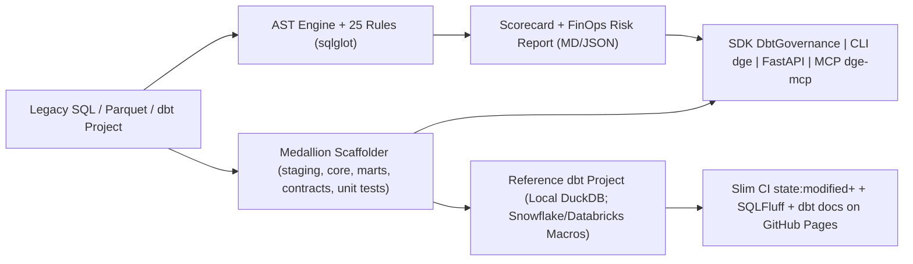

# dbt-dataops-governance-engine

> **AI-Accelerated Analytics Engineering:** static SQL/dbt AST auditor (`sqlglot`), automated Medallion scaffolder, ODCS v3.1 contract validator and Slim CI governance engine (`Python`, `dbt`, `DuckDB`, `Snowflake`, `Databricks`).

---

## 1. Architecture & Target Flow



### Core Capabilities
1. **Zero-Execution Static AST Auditor ([ADR-001](docs/adr/ADR-001-static-ast-sqlglot-engine.md)):**
   - Parses SQL and dbt Jinja models into `sqlglot` ASTs across `duckdb`, `snowflake`, `spark` (Databricks), and `bigquery` **without executing** audited queries.
   - Evaluates **25 declarative rules** in [`catalog/governance_rules.yaml`](catalog/governance_rules.yaml) across `PERFORMANCE_FINOPS` (7), `MODELING_MEDALLION` (6), `QUALITY_CONTRACTS` (6), and `LGPD_PII_SECURITY` (6).
2. **Multi-Cloud Transpilation & Incremental Optimization:**
   - Translates analytical SQL across `DuckDB`, `Spark SQL`, and `Snowflake` with explicit incompatibility reporting and `full-refresh` to `incremental` migration guidance.
3. **Medallion Scaffolder & ODCS v3.1 Contracts ([ADR-002](docs/adr/ADR-002-medallion-scaffolder-odcs-v31.md)):**
   - Generates `sources.yml`, `stg_*.sql` (casting, trimming, sentinel-to-`NULL` normalization, canonical `STRING` keys), `dim_*`/`fct_*`, 100% documented `_models.yml` with `contract: {enforced: true}`, schema tests, dbt unit test skeletons, and ODCS v3.1 `contract.yaml` specs.
   - Enforces strict output path validation (anti-traversal), **Client Path Shield**, and `<untrusted_data>` MCP output wrapping (`OWASP LLM01`).
4. **Portable Reference dbt Project, Slim CI & 4-Interface Parity:**
   - Reference synthetic dbt project on DuckDB with portable cross-warehouse macros ([`catalog/macros_registry.yaml`](catalog/macros_registry.yaml)), Slim CI (`state:modified+`), SQLFluff (`jinja` templater), and unified `CLI` (`dge`), `SDK` (`DbtGovernance`), `FastAPI`, and `MCP` (`dge-mcp`) interfaces.

---

## 2. Local Setup & Verification

### Prerequisites
- Python `3.12+` with strictly pinned dependencies in [`requirements.txt`](requirements.txt) and [`requirements-dev.txt`](requirements-dev.txt).

```bash
python -m venv .venv
source .venv/bin/activate  # Windows PowerShell: .\.venv\Scripts\Activate.ps1
pip install -r requirements.txt -r requirements-dev.txt
pip install --no-deps -e .

# Static analysis, catalog/progress sync & offline test suite
ruff check .
python scripts/validate_catalog.py
python scripts/render_catalog.py --check
python scripts/render_progress.py --check
pytest -m "not live" -v
```

---

## 3. Repository Map

| Path | Purpose |
| :--- | :--- |
| [`docs/adr/`](docs/adr/) | Architecture Decision Records (`ADR-001`, `ADR-002`) |
| [`catalog/`](catalog/) | Declarative 25-rule governance catalog (`governance_rules.yaml`) and portable macro registry (`macros_registry.yaml`) |
| [`scripts/`](scripts/) | Deterministic catalog validator (`validate_catalog.py`) and Markdown renderers (`render_catalog.py`, `render_progress.py`) |
| [`state/`](state/) | Live phase progress tracker (`project_progress.json`) |
| [`src/dbt_dataops_governance/`](src/dbt_dataops_governance/) | Python package implementing the governance engine, scaffolder, transpiler, and 4 interfaces |
| [`tests/`](tests/) | Deterministic offline pytest suite (`pytest -m "not live"`) |
| [`CATALOG.md`](CATALOG.md) | Deterministically rendered rules & macros catalog |
| [`JORNADA_IMPLEMENTACAO.md`](JORNADA_IMPLEMENTACAO.md) | Live phase-by-phase implementation progress tracker (Portuguese) |
