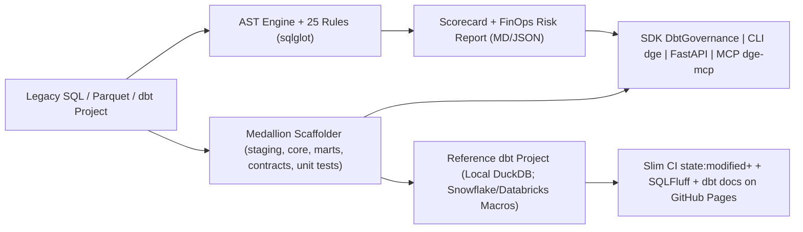

# dbt-dataops-governance-engine

> **AI-Accelerated Analytics Engineering:** static SQL/dbt AST auditor (`sqlglot`), automated Medallion scaffolder, ODCS v3.1 contract validator and Slim CI governance engine (`Python`, `dbt`, `DuckDB`, `Snowflake`, `Databricks`).

---

## 1. Architecture & Target Flow



### Core Capabilities
1. **Zero-Execution Static AST Auditor ([ADR-001](docs/adr/ADR-001-static-ast-sqlglot-engine.md)):**
   - Parses SQL and dbt Jinja models into `sqlglot` ASTs across `duckdb`, `snowflake`, `spark` (Databricks), and `bigquery` **without executing** audited queries.
   - Evaluates **25 declarative rules** in [`catalog/governance_rules.yaml`](catalog/governance_rules.yaml) across `PERFORMANCE_FINOPS` (7), `MODELING_MEDALLION` (6), `QUALITY_CONTRACTS` (6), and `LGPD_PII_SECURITY` (6).
2. **Multi-Cloud Transpilation & Incremental Optimization ([Limitations Matrix](docs/TRANSPILATION_LIMITATIONS.md)):**
   - Translates analytical SQL across `DuckDB`, `Spark SQL`, and `Snowflake` (plus `BigQuery` read/transpile) with explicit incompatibility reporting and `full-refresh` to `incremental` migration guidance.
3. **Medallion Scaffolder & ODCS v3.1 Contracts ([ADR-002](docs/adr/ADR-002-medallion-scaffolder-odcs-v31.md)):**
   - Generates `sources.yml`, `stg_*.sql` (casting, trimming, sentinel-to-`NULL` normalization, canonical `STRING` keys), `dim_*`/`fct_*`, 100% documented `_models.yml` with `contract: {enforced: true}`, schema tests, dbt unit test skeletons, and ODCS v3.1 `contract.yaml` specs from Parquet, CSV, DuckDB, or SQL DDL.
   - Enforces strict output path validation (anti-traversal), **Client Path Shield**, and `<untrusted_data>` MCP output wrapping (`OWASP LLM01`).
4. **Portable Reference dbt Project, Slim CI & 4-Interface Parity:**
   - Synthetic reference dbt project ([`dbt/`](dbt/)) on DuckDB with portable cross-warehouse macros ([`catalog/macros_registry.yaml`](catalog/macros_registry.yaml)), Slim CI (`state:modified+`), SQLFluff (`templater = jinja`), GitHub Pages lineage publishing, and unified `CLI` (`dge`), `SDK` (`DbtGovernance`), `FastAPI`, and `MCP` (`dge-mcp`) interfaces.

---

## 2. 60-Second Quickstart & Verification

### Install (Python 3.12+)

```bash
git clone https://github.com/jhsfhtls/dbt-dataops-governance-engine.git
cd dbt-dataops-governance-engine
python -m venv .venv
source .venv/bin/activate  # Windows PowerShell: .\.venv\Scripts\Activate.ps1
pip install -r requirements.txt -r requirements-dev.txt
pip install --no-deps -e .
```

### Run `dge audit` & `dge scaffold` (< 10 s after install)

```bash
# 1. Audit synthetic legacy SQL statically (Scorecard + FinOps/LGPD risk)
dge audit examples/legacy_sql_sample.sql --dialect duckdb --format markdown

# 2. Scaffold a Medallion dbt project + ODCS v3.1 contract from DDL into /tmp/demo_lakehouse
dge scaffold "CREATE TABLE orders (order_id VARCHAR PRIMARY KEY, postal_code VARCHAR, total_usd DOUBLE);" \
  --source-type ddl --output-dir /tmp/demo_lakehouse

# 3. Inspect rules, transpile across warehouses, and extract dbt lineage
dge rules --family LGPD_PII_SECURITY --format table
dge transpile --sql "SELECT DATE_TRUNC('month', order_date) AS m FROM orders" --source duckdb --target snowflake --format sql
dge lineage dbt/models --format mermaid
```

### Python SDK, FastAPI & MCP (`dge-mcp`)

```python
from dbt_dataops_governance import DbtGovernance

gov = DbtGovernance()
report = gov.audit("examples/legacy_sql_sample.sql", dialect="duckdb")
print(report["score"], report["grade"], report["finops_risk_level"])
```

```bash
# FastAPI REST Gateway (OpenAPI docs at /docs)
uvicorn dbt_dataops_governance.api.app:create_app --factory --reload

# Stdio MCP Server (JSON-RPC 2.0 with <untrusted_data> framing)
dge-mcp
```

### Full Local Quality & CI Gates

```bash
ruff check .
sqlfluff lint dbt/models
python scripts/validate_catalog.py
python scripts/render_catalog.py --check
python scripts/render_progress.py --check
dbt build --project-dir dbt --profiles-dir dbt
dbt docs generate --project-dir dbt --profiles-dir dbt
python scripts/lint_dbt_docs.py
pytest -m "not live" -v
```

---

## 3. Repository Map

| Path | Purpose |
| :--- | :--- |
| [`docs/adr/`](docs/adr/) & [`docs/TRANSPILATION_LIMITATIONS.md`](docs/TRANSPILATION_LIMITATIONS.md) | Architecture Decision Records (`ADR-001`, `ADR-002`) and multi-cloud transpilation matrix |
| [`catalog/`](catalog/) | Declarative 25-rule governance catalog (`governance_rules.yaml`) and portable macro registry (`macros_registry.yaml`) |
| [`src/dbt_dataops_governance/`](src/dbt_dataops_governance/) | Core package (`auditor`, `transpiler`, `scaffolder`, `lineage`, `sdk`, `cli`, `api`, `mcp`) |
| [`dbt/`](dbt/) | Reference synthetic DuckDB dbt project (`staging` -> `core` -> `marts`) with 4 portable cross-warehouse macros |
| [`examples/`](examples/) | Synthetic legacy SQL input and versioned Markdown/JSON sample audit reports |
| [`scripts/`](scripts/) | Catalog validator, deterministic renderers, `lint_dbt_docs.py` (100% coverage), and `run_slim_ci.py` (`state:modified+`) |
| [`state/`](state/) & [`tests/`](tests/) | Live progress JSON tracker (`project_progress.json`) and deterministic offline `pytest` suite |
| [`CATALOG.md`](CATALOG.md) & [`JORNADA_IMPLEMENTACAO.md`](JORNADA_IMPLEMENTACAO.md) | Rendered rules/macros catalog and Portuguese implementation progress dashboard |
